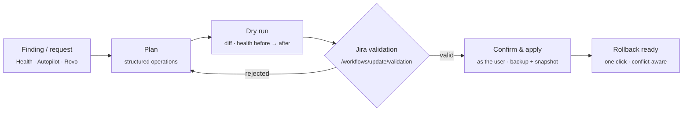
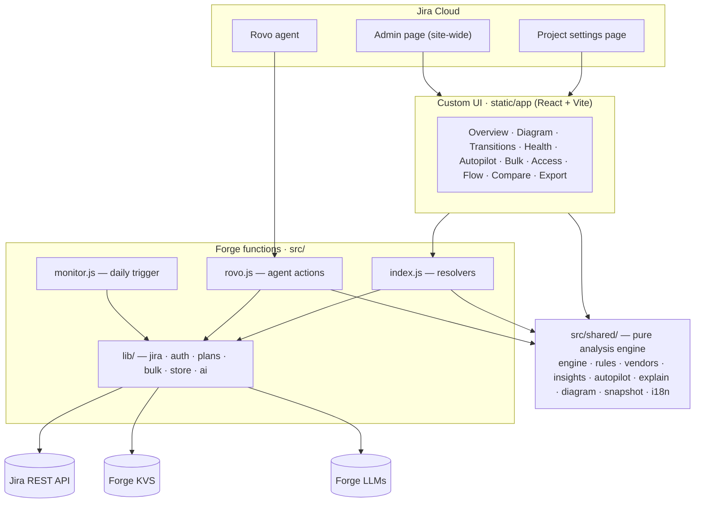

<div align="center">


# Superport Workflow Analyzer

**See every Jira workflow, understand every rule, fix what is broken. With one click and one-click undo.**

A Jira Cloud app built on Atlassian Forge. It reads workflows live from Jira, explains them in plain language, finds risks, documents everything and makes safe, reversible changes.


</div>

---

## Why

Atlassian no longer offers the workflow XML download, and the old XML-based *Workflow Parser* went with it. The Workflow Analyzer replaces it and does far more:

- **No export, no copy-paste.** Workflows come straight from the Jira REST API, always current.
- **From finding to fix in two clicks.** Every health finding comes with a recommendation. Many can be fixed automatically, and every change runs through a preview, Jira's own validation and a stored backup.
- **Nothing happens behind your back.** Plans never touch Jira. Applying is always confirmed, runs as you, and can be rolled back.

## Highlights

| | |
|---|---|
| 🧭 **Overview** | Health score, KPIs, apps in use, a governance score per area and a prioritised **action plan (P1–P3)**. |
| 🗺️ **Diagram** | Interactive graph with pan, zoom, path highlighting and overlays for issue load, persona access and impact. Exports as SVG, PNG or Mermaid. |
| 📋 **Transitions** | The familiar per-status table: conditions (with AND/OR groups), validators, post functions, screens, properties and team notes. Filter by vendor, search with highlighting. |
| 🔗 **Dependencies** | Every app, group, role, field, user, screen, status and permission used by workflow rules, down to the transition, including references inside JMWE, JSU and ScriptRunner configurations. |
| 🩺 **Health check** | Dead ends, unreachable statuses, Done transitions that miss or clear the resolution, Done transitions firing the Generic Event (no resolved/closed mails), unguarded global transitions, deleted groups, inactive users, disabled rules, licence-dependent app rules and more. Each comes with a fix. |
| 🧹 **Issue resolutions** | The damage a wrong workflow already did: issues that are Done but Unresolved (counted as open in every report) and open issues that still carry a resolution. Review the list with a suggested resolution per status and repair all of them in one go without touching the status (Jira admins: no mails). Jira Cloud cannot clear a resolution by editing, so clearing runs the workflow's own transition into the issue's current status – and can be undone. |
| ⚡ **One-click fixes** | **Fix automatically** on any finding the app can repair, or **Fix N automatically** for a whole category. Findings that need judgement get **Fix with AI**: a precise, ready-to-send change request. |
| ✦ **Autopilot** | Describe a change in plain English or German. It becomes structured operations, then a dry run with a diff and the health score before and after, then validation by Jira, then **apply → one-click rollback**. |
| 🌐 **Site-wide bulk changes** | Jira admins change many workflows at once. Each workflow is planned, validated, applied and rolled back on its own, with live progress. Site-wide auto-fix plans every workflow with its own repairs. |
| 🔁 **Freshness built in** | Plans older than 7 days are marked *expired*, and plans for a workflow that changed since are flagged. **Plan again on the current version** is one click. |
| 🕓 **Since your last visit** | New and resolved findings per user, with a jump straight to what is new. A daily monitor records configuration changes. |
| 👥 **Access simulator** | Who can run which transition: personas, path finder A → B, and a who-can-do-what matrix. |
| 📈 **Live flow** | Issue counts and stale issues per status, bottlenecks and never-used statuses. |
| 🆚 **Compare** | Side-by-side comparison and detection of near-duplicate workflows. |
| 🤖 **Rovo agent** | *Workflow Analyst* answers questions and can plan, apply, roll back and auto-fix changes in chat, always with a confirmation. |
| 📤 **Export** | A single interactive HTML file (Confluence-ready), a branded PDF, CSV for Excel, and JSON. |
| 🌍 **EN / DE** | Every screen, plan message and export in both languages, remembered per user. Follows Jira's light or dark theme. |

## How a change flows



What every change goes through:

- **Re-checked on apply.** The operations are applied again to the *latest* version of the workflow, so a colleague's edits are never overwritten.
- **Protected against double applies.** A lock means a double click, or two admins at once, changes Jira exactly once.
- **Conflict-aware rollback.** A rollback compares the workflow's *content*, not its version number. If someone changed the workflow after the apply, it asks before undoing their work too.
- **Shared workflows need confirmation.** Changing a workflow used by more than one project is confirmed explicitly, and project names you cannot see stay hidden.

## Roles and security

The app works out each user's role on the server and never trusts the client.

| Role | Can see | Can change |
|---|---|---|
| **Jira admin** | Every project and the site-wide page | All workflows, including shared company-managed ones and bulk changes |
| **Project admin** | Their project's workflows | Team-managed workflows of their own project |
| **Anyone else** | Nothing (a uniform "not available") | Nothing |

- **Project from the Forge context.** The project always comes from the Forge context, never from the payload.
- **Checked on every call.** Every resolver checks permissions first, and every write runs `asUser`.
- **Hostile input rejected.** IDs, storage keys and payloads are validated against hostile input and prototype pollution.
- **AI off by default.** The AI features (AI chat, "Plan with AI", Bulk "Describe (AI)", every Rovo action) stay off until a Jira admin turns them on in the site-wide page (Settings › AI features, KVS key `ai-settings`). Only users with "Administer Jira" can change it, checked live on every change; each change is logged with who and when. While off, every AI entry point is refused on the server (`AI_DISABLED`), and the UI hides every AI entry point (no greyed-out buttons, no notice): it reads the effective flag (switch on AND no vendor stop) from `bootstrap` (`static/app/src/lib/aiState.js`, off on any error) and re-checks it when the page gets focus or becomes visible again. The Autopilot then offers auto-fix and templates only, and the "AI assistant" tab becomes "Explanations".
- **Monthly Forge LLM budget, set by SUPERPORT.** Forge LLM usage is billed to SUPERPORT, so SUPERPORT sets the limits through its App Status app in the Forge variable `AI_BUDGET` (kind "eur" of the App Status contract; like `APP_MAINTENANCE`: `forge variables set` + redeploy, read only on the server, nothing a customer can change), e.g. `{"eurPerMonth":20,"eurPerUsd":1,"dailyPerPerson":60,"stop":false,"sites":{"bigcorp.atlassian.net":100},"callsPerMonth":1000,"tokensPerMonth":2000000,"siteCaps":{"bigcorp.atlassian.net":{"callsPerMonth":5000}}}`. Unset or invalid (logged once) means the defaults: **20 EUR** (`EUR_PER_MONTH` in `src/lib/aiBudget.js`), 1,000 LLM calls and 2,000,000 tokens per site and calendar month (UTC) (`src/lib/aiLimits.js`). Every answer is priced from the tokens Atlassian reports (Forge LLM price list, unknown models at the highest price, missing usage estimated) and added to the month's meter; no new call starts from 98 % of the EUR budget. `dailyPerPerson` is accepted for the contract but not used. `siteCaps` are matched against the site host from `serverInfo.baseUrl` (looked up only when `siteCaps` is set); a missing field falls back to the app-wide value. Calls and tokens are counted in KVS under `llm-usage:YYYY-MM` and checked before every model call (`AI_LIMIT`). Jira admins see the usage and their site's limits next to the switch.
- **Paid via Atlassian.** `app.licensing.enabled` in the manifest: on a site without an active Marketplace licence every resolver and Rovo action is refused with `LICENSE_INACTIVE` (`src/lib/license.js`) before Jira, storage or the AI is touched, the UI shows a licence notice (`availability.licensed`, preview with `#license=inactive`) and the daily monitor runs only on licensed sites (`filter.appIsLicensed`). Installs without a license object (development) work as before. Prices (free up to 10 users) are set in the Marketplace partner portal, not in code.
- **Vendor stop.** `"stop":true` in `AI_BUDGET` (or a limit of 0 EUR, calls or tokens for all sites or one site) refuses every AI entry point, including every Rovo action, with `AI_STOPPED` ("AI features are temporarily turned off by the app vendor. Please try again later."), even where a Jira admin turned the AI on; the admin's setting is kept and applies again once the stop is lifted.
- **Minimal scopes:** `read:jira-work`, `write:jira-work`, `read:jira-user`, `manage:jira-configuration`, `storage:app`.

## Architecture



The analysis engine in `src/shared/` is plain JavaScript with no dependencies. The backend, the UI, the exports and the Rovo agent all run the same code, so every surface gives the same answers.

```
manifest.yml            Forge modules: projectSettingsPage, adminPage, rovo:agent + actions, scheduledTrigger
src/
  index.js              Resolvers (bootstrap, project data, notes, snapshots, plans, bulk, site scan)
  rovo.js               Rovo agent actions (authorise first, then read)
  monitor.js            Daily change monitoring
  lib/                  jira.js (REST, paging, retry) · auth.js (roles) · plans.js (plan/apply/rollback)
                        bulk.js (site-wide changes) · store.js (KVS) · ai.js (Forge LLM)
  shared/               Analysis engine shared by backend, UI, exports and Rovo
static/app/             Custom UI (React 19, Vite 7, jsPDF), EN/DE, light/dark
tests/                  Node test runner · FakeJira (in-memory Jira) · fixtures · fuzz generator
locales/                Manifest translations
scripts/                i18n check, user-guide generator
```

## Getting started

### Prerequisites

- Node.js 22 or newer
- The [Forge CLI](https://developer.atlassian.com/platform/forge/getting-started/): `npm install -g @forge/cli`
- A Jira Cloud site where you are an admin

### Install and run locally

```bash
npm install
npm --prefix static/app install

npm test                 # 135 tests: engine, fuzzing, E2E against FakeJira, adversarial, security, compatibility
npm run check:i18n       # every translation key exists in EN and DE
npm run dev:ui           # UI with mock data on http://localhost:5174
```

The mock UI simulates a full Jira. A few URL hashes switch scenarios:

| Hash | Scenario |
|---|---|
| `#admin` | Site-wide admin page |
| `#role=project` | Project admin (not a Jira admin) |
| `#forbidden` | User without access |
| `#digest` | A previous visit, so the "since your last visit" digest shows |
| `#shared` | Plans on a workflow shared by several projects |
| `#ai=on` / `#ai=off` | Force the AI switch on or off (without it, the switch is stored in the mock and starts off, like on a real site) |
| `#ai=limit` | AI on, monthly quota used up |

### Deploy to your site

```bash
forge login                                              # once, with your Atlassian API token
forge register                                           # once – writes your app id into manifest.yml
npm run build:ui
forge deploy -e development
forge install --site <your-site>.atlassian.net --product jira -e development
```

Then open **Project settings › Workflow Analyzer** in any project, or **Jira settings › Apps › Workflow Analyzer (site-wide)**. The Rovo agent is under **Rovo chat › Agents › Workflow Analyst**.

> **Production:** deploy with `-e production`. A change to the scopes needs `forge install --upgrade` on every site.

## Testing philosophy

Tests check **what Jira ends up containing**, not only what the app reports. **FakeJira** is an in-memory Jira that implements the REST behaviour verified against a live site:

- version bumps and regenerated rule IDs;
- paged usages and archived projects;
- rate limits and injected faults.

| Suite | Covers |
|---|---|
| `engine`, `insights`, `autopilot` | Analysis, findings, governance, the operation engine |
| `fuzz` | Thousands of random workflows and operations: no crash, no invalid payload |
| `backend.e2e` | Resolvers, plans, apply and rollback, Rovo, monitoring |
| `fixflow.e2e` | One-click fixes, site-wide auto-fix, re-planning, the visit digest, localised messages |
| `adversarial.e2e` | Double applies, conflicting rollbacks, injected Jira failures, hostile payloads, scale |
| `security.e2e` | Every resolver refuses users without rights and leaves no trace; roles cannot escalate |
| `ai-settings` | AI switch off by default, only Jira admins can change it, every AI entry point refuses while off, monthly quota and month rollover |
| `ai-ui-gating` | The UI's effective AI flag (switch on and not stopped; off by default and on errors) and a source check that every AI entry point is hidden while AI is off |
| `compat.e2e` | Team-managed, Service Management, 5,000+ groups, 450 projects sharing a workflow, sites without AI |

## Contributing

1. Keep `src/shared/` free of dependencies and side effects. It runs in the backend, the browser and the exports.
2. Every new user-facing string goes into `src/shared/i18n*.js` in **both** EN and DE (`npm run check:i18n`).
3. Every write path needs a FakeJira test that checks Jira's resulting state and the rollback.
4. Run `npm test` and `npm run build:ui` before you deploy.

## License

Proprietary. © Superport. All rights reserved.
